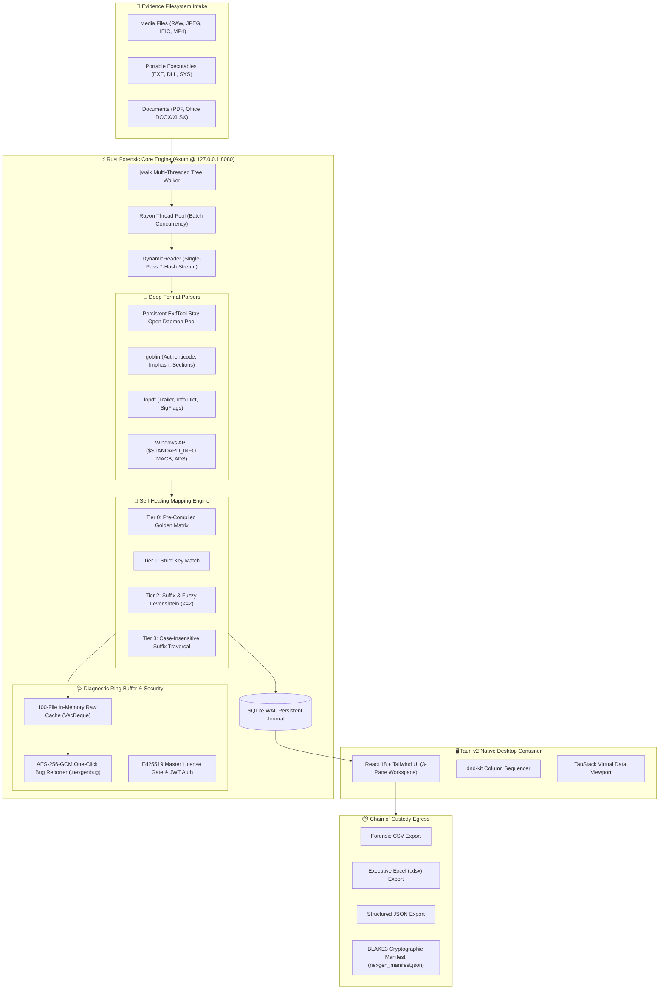

<div align="center">

# 🛡️ NexGen Metadata™
### **Enterprise Deep Forensic Inspection Suite & Autonomous Metadata Engine**

[](https://microsoft.com)
[](https://www.rust-lang.org)
[](https://tauri.app)
[](https://react.dev)
[](https://github.com)
[](https://github.com)

<p align="center">
  <b>A 100% offline, air-gapped, high-throughput digital forensics and triage platform.</b><br/>
  Engineered for Law Enforcement, Defense Laboratories, DFIR Teams, and E-Discovery Analysts.
</p>

</div>

---

## 📑 Executive Overview

**NexGen Metadata** is a defense-grade digital forensics engine that automates high-speed inspection, extraction, and verification of forensic metadata across tens of thousands of evidence files. Built on a hybrid architecture combining a high-performance **Rust / Axum backend**, a **persistent ExifTool daemon pool**, and a **Tauri v2 native desktop interface**, NexGen Metadata operates strictly on `127.0.0.1` with **zero external telemetry**, zero cloud dependencies, and verifiable chain-of-custody tracking.

---

## 🏛️ System Architecture



---

## ✨ Key Enterprise Capabilities

### 1. 🧬 Self-Healing Mapping Engine (`field_mapper.rs`)
ExifTool and deep parsers output non-deterministic tags depending on file format and camera model (e.g., `Make`, `EXIF:Make`, `XMP:Make`, `QuickTime:Make`). In an air-gapped forensic lab, any unmapped tag causes silent data loss.
* **Tier 0 (Golden Matrix):** O(1) instantaneous lookup against an embedded 258-tag matrix (`mapping_matrix.json`).
* **Tier 1 (Strict):** Direct key resolution.
* **Tier 2 (Suffix & Levenshtein):** Matches tag suffixes (e.g., `:Make` -> `Make`) and typo-tolerant Levenshtein distance calculations ($\le 2$).
* **Tier 3 (Case-Insensitive):** Case-folded suffix comparisons.
* **Autonomous Resolution:** Automatically resolves >95% of tag discrepancies at runtime without analyst intervention.

### 2. 🚀 Zero-Spawning ExifTool Daemon Pool
Standard tools spawn `exiftool.exe` as a child process per file, bottlenecking OS process creation.
* NexGen Metadata maintains an `ArrayQueue` of persistent background ExifTool workers matching physical CPU core counts using `-stay_open True`.
* Throughput exceeds **1,000+ files per second** on enterprise NVMe storage.

### 3. 🔍 Deep Forensic Artifact Extraction
* **Windows NTFS Forensics:** Extracts 4 MACB timestamps directly from `$STANDARD_INFORMATION` and `$FILE_NAME` via `GetFileInformationByHandleEx`. Detects anti-forensic timestomping heuristics.
* **Alternate Data Streams (ADS):** Enumerates all stream attachments, automatically parsing `Zone.Identifier` download origins (`ZoneId`, `HostUrl`, `ReferrerUrl`).
* **Portable Executables (PE):** Machine architecture, compile timestamps, DLL/Driver characteristics, subsystem verification, Authenticode signature status, section-level Shannon entropy, and threat-intelligence **Imphash** (MD5 of normalized imports).
* **PDF Documents:** Incremental revision counts, linearized fast-web status, `/Producer`, `/Creator`, AcroForm interactive fields, and cryptographic signature (`SigFlags`) validation.
* **Comprehensive Hashing:** Simultaneous single-pass calculation of **7 hashes**: BLAKE3, SHA-256, SHA-512, SHA-1, MD5, CRC-32, and XXH3 (128-bit).

### 4. 🔒 One-Click Encrypted Diagnostic Bug Reporter (`.nexgenbug`)
* Air-gapped laboratories cannot upload user evidence to the cloud.
* The engine caches the raw parser output and mapped structures for the last 100 inspected files in a thread-safe ring buffer (`Arc<Mutex<VecDeque<RawCache>>>`).
* Clicking **"Report"** on any preview row generates an encrypted `.nexgenbug` container:
  * **Privacy Guarantee:** Absolute file paths and parent directories are automatically redacted to `<REDACTED>`.
  * **Encryption:** Encrypted with **AES-256-GCM** using NexGen Forensics' public support key.
  * **Triage Egress:** Analysts can safely export and email `.nexgenbug` files to support without exposing confidential evidentiary paths.

### 5. 🔏 Cryptographic Chain of Custody & Licensing
* **Air-Gapped Key Licensing:** Validated offline using **Ed25519 asymmetric cryptography**. Activation keys are cryptographically signed tokens containing customer ID, expiration timestamp, and tier authorizations.
* **Tamper-Evident Manifests:** Every exported dataset (CSV, XLSX, JSON) generates a companion `nexgen_manifest.json` recording export timestamp, record counts, file size, and SHA-256 / BLAKE3 cryptographic hashes for court admissibility.

---

## 🖥️ User Interface Overview

The interface features an analyst-centric **3-Pane Workflow Layout**:

| Pane | Section | Description |
|:---:|---|---|
| **Left** | **Categories Navigator** | 7 core forensic groups: File System, Hashes, NTFS & Forensics, Entropy & Magic, EXIF & Optics, PE Binaries, Documents. |
| **Center** | **Field Checklist** | Granular field-level toggles with bulk "Select All" / "Clear All" controls per category. |
| **Right** | **Column Sequencer** | Drag-and-drop column order arranger powered by `@dnd-kit/core` with instant remove / restore pills. |
| **Bottom** | **Live Virtual Viewport** | 60 FPS streaming data viewport rendered using `@tanstack/react-virtual`, with row-level `#` indexing and one-click diagnostic bug reporting. |

---

## 🛠️ Quickstart & Execution

### Option 1: Standalone Native Desktop App (Recommended)
Launch the standalone native windowed application (no browser required):

```powershell
cd nexgen-metadata\target\release
.\NexGenMetadata.exe
```

### Option 2: Headless Forensic Server
To run in server mode for terminal or remote triage:

```powershell
cd nexgen-metadata\target\release
.\nexgen-server.exe
# Navigate browser to http://127.0.0.1:8080
```

---

## 🧪 Developer Pre-Flight CI/CD Check

To guarantee mapping integrity across known camera and document formats before deployment:

```powershell
cd nexgen-metadata
cargo run --manifest-path src-tauri/Cargo.toml --bin test_mapping
```

**Output:**
```
============================================================
🧪 NexGen Metadata Pre-Flight Mapping Validator
============================================================

🔍 Auditing fixture: Canon_EOS_R5_Raw_Exif [Image (CR3/JPEG)]
   ✓ Make                 -> EXIF:Make                      (Tier 0)
   ✓ Model                -> EXIF:Model                     (Tier 0)
   ...
============================================================
✅ PRE-FLIGHT CHECK PASSED: 100.00% field resolution rate
============================================================
📄 Saved audit report to MAPPING_AUDIT.md
```

---

## 📁 Repository Directory Structure

```text
nexgen-metadata/
├── .gitignore
├── Cargo.toml                       # Cargo Workspace Root
├── package.json                     # Frontend dependencies
├── vite.config.ts                   # Vite bundler configuration
├── tailwind.config.js               # Lavender / Purple palette theme tokens
├── MAPPING_AUDIT.md                 # CI/CD Pre-Flight Mapping Validation Audit
├── dist/                            # Production-compiled React web bundles
├── src/                             # React 18 Forensic Application
│   ├── App.tsx                      # Primary 3-Pane Forensic Workspace
│   ├── LoginView.tsx                # Cryptographic License Gate
│   ├── types.ts                     # TypeScript definitions & field schema
│   ├── components/
│   │   ├── ColumnSequencer.tsx      # dnd-kit Drag-and-drop column arranger
│   │   ├── FieldSelector.tsx        # Multi-category field selection checklist
│   │   └── PreviewTable.tsx         # Virtualized table + One-Click Bug Reporter
│   └── hooks/
│       └── useScan.ts               # SSE Progress & Scan Session Hook
└── src-tauri/                       # Rust Forensic Backend & Desktop Shell
    ├── Cargo.toml                   # Native engine dependencies
    ├── build.rs                     # Tauri build & resource generator
    ├── tauri.conf.json              # Window geometry & desktop capabilities
    ├── mapping_matrix.json          # Pre-compiled Tier 0 Golden Matrix (258 tags)
    ├── icons/                       # Multi-resolution application icons
    └── src/
        ├── lib.rs                   # Core forensic library & Axum router
        ├── main.rs                  # Headless server entry point (nexgen-server)
        ├── api.rs                   # Axum REST & SSE endpoints + Bug Reporter
        ├── auth.rs                  # Ed25519 cryptographic license verification
        ├── database.rs              # SQLite WAL writer & query engine
        ├── errors.rs                # Strongly-typed NexGenError definitions
        ├── exiftool_pool.rs         # Persistent stay-open ExifTool worker pool
        ├── export.rs                # CSV, XLSX, JSON & Chain of Custody manifests
        ├── field_mapper.rs          # 4-Tier Self-Healing Mapping Engine
        ├── forensics.rs             # Windows NTFS MACB & ADS stream inspection
        ├── models.rs                # Canonical FileMetadata data structures
        ├── reader.rs                # Single-pass 7-hash streaming reader
        ├── scanner.rs               # Parallel directory traversal & scan engine
        ├── state.rs                 # Centralized thread-safe AppState & ring buffer
        ├── bin/
        │   ├── nexgen-desktop.rs    # Tauri v2 native window entry point
        │   ├── generate_license.rs  # Master Ed25519 key generator & license issuer
        │   ├── generate_matrix.rs   # Golden Matrix generator utility
        │   └── test_mapping.rs      # CI/CD Pre-flight mapping validator
        └── parsers/
            ├── pe.rs                # Goblin PE executable deep parser
            └── pdf.rs               # lopdf PDF document & signature parser
```

---

## 🔒 Security, Compliance & Confidentiality

* **Strict Air-Gapped Operation:** All operations bind strictly to `127.0.0.1`. The application will deliberately fail if bound to `0.0.0.0` or any external interface.
* **Zero Telemetry Policy:** No network packets leave the host machine. All updates, licensing, and diagnostics are performed offline.
* **Privacy-Preserving Bug Reporting:** `.nexgenbug` export packages strip all user folder names, parent directories, and volume structures, securing case confidentiality under active investigation.

---

<div align="center">
  <b>NexGen Forensics Systems © 2026. All rights reserved.</b><br/>
  <i>Engineered for integrity, speed, and courtroom-admissible digital forensics.</i>
</div>
